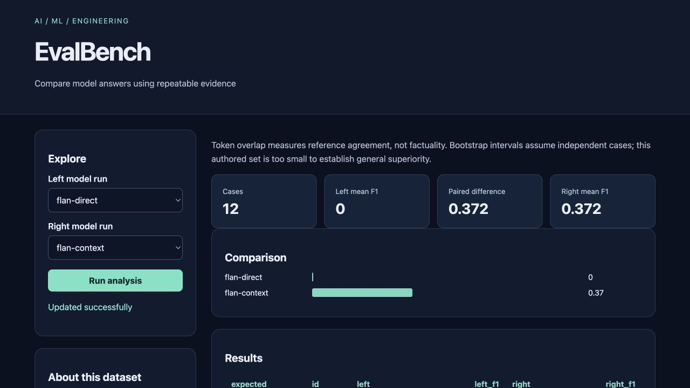

# EvalBench

Compare model answers using repeatable evidence for **ai engineers**.

Original topic: **LLM Evaluation Platform** from [the source post](https://www.instagram.com/p/DdyMaogE4ud/).

> Local portfolio implementation developed with Codex assistance. Measured results and limitations are documented; no production adoption, revenue or hiring outcome is claimed.



## What works

- Dataset validation
- local endpoint adapters
- scoring
- paired bootstrap
- cost logs

[Example output](reports/example-output.json) · [Recorded checks](reports/test-results.txt) · [Learning and interview guide](LEARNING_GUIDE.md)

## Start

Python 3.12 is the validated Python runtime. Run commands from this repository directory. Windows users activate `.venv\Scripts\activate` instead of `source`.

```sh
python3.12 -m venv .venv
source .venv/bin/activate
python -m pip install -r requirements.txt
python run_models.py
python app.py
```

Open **http://127.0.0.1:8080**. Keep the process running. Set `PORT` to use another port. The Python development servers are intended for local demonstrations.

## Demonstration

Run run_models.py to generate both actual model runs. Compare their paired scores, inspect individual failures and change the left/right selection. Identical runs produce zero difference.

## Architecture and decisions

Browser controls → validated Flask API → project analysis/workflow → results and export.

Stack: Python · Flask.

1. Compare runs on identical case IDs and reject incomplete or mismatched response sets.
2. Separate actual generated responses, model metadata, latency and token counts from scoring code.
3. Use paired bootstrap resampling of case-level differences rather than unrelated confidence intervals.

## Verification

```sh
python -m pytest -q
```

See [VERIFICATION.md](VERIFICATION.md) for actual executed checks, setup verification, model/data results and any outstanding environment limitations. The [recorded CI runs](reports/ci-verification.json) passed for the linked source revision.

## Data and attribution

Authored QA cases; explicit recorded responses. See [DATA_AND_SOURCES.md](DATA_AND_SOURCES.md) for provenance and usage notes. Original project code is MIT unless a preserved source file or dependency states otherwise. Model and third-party data licenses remain separate.

## Limitations and next improvement

Twelve authored cases; reference token overlap is not factuality, safety or human preference. Local measured latency is hardware-specific. Zero API cost excludes electricity and hardware. Direct/context prompts use the same model, so this is a prompt-configuration comparison.

Suggested extension: Add a second model adapter and preserve complete case coverage and provenance.

## Honest portfolio use

This implementation and documentation were developed with substantial Codex assistance. Before presenting it, run the demonstration, explain the design choices, and complete the suggested independent modification. Do not describe generated code as work experience, an accepted upstream contribution, or a deployed production service.

## Connect

[LinkedIn — Abhijith Viswanathan](https://www.linkedin.com/in/abhijith-viswanathan-0a7216436/)
